<div align="center">

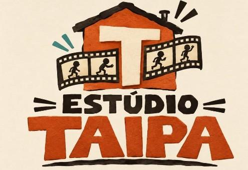

### Construímos o Brasil quadro a quadro.

Site institucional do **Estúdio Taipa**, produtora independente e cultural brasileira<br/>
que leva a cultura popular ao audiovisual por meio do **Stop Motion**.

<br/>

<a href="https://estudiotaipa.pages.dev/"></a>

<br/><br/>

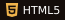
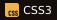
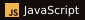
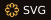
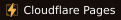

</div>

<br/>

<a href="https://estudiotaipa.pages.dev/">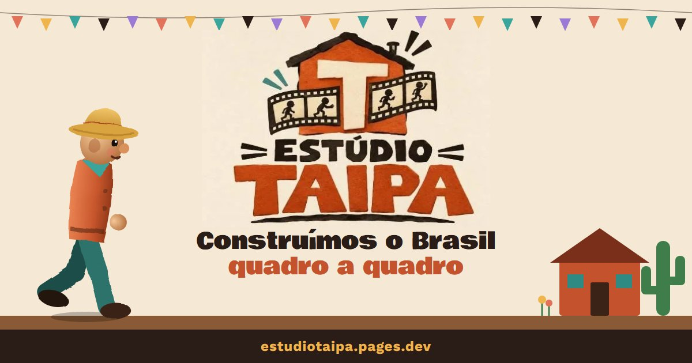</a>

## 🎞️ Stop motion feito em código

O destaque do site é um **boneco de massinha de chapéu de palha** desenhado em SVG que caminha por um cenário nordestino (casinha, mandacaru, cerca e bandeirinhas), como numa animação feita à mão:

- ciclo de caminhada com **24 poses a 12 quadros por segundo**;
- **"tremido" aleatório** a cada quadro e textura de massinha que "ferve" (`feTurbulence`);
- piscada, sombra e luz que variam, e cenário que anda em degraus;
- só anima quando está visível na tela, para não pesar.

## ✨ O que tem no site

| | |
|---|---|
| 🎬 **Abertura** | Preloader com contador de quadros e logo que cai com efeito de stop motion |
| 🧱 **Quem somos** | Manifesto que acende palavra a palavra e parede de taipa montada em camadas |
| 📷 **Stop Motion** | Seção fixa com "tela de câmera" que muda a cada passo da rolagem |
| 🗓️ **Trajetória** | Linha do tempo de 2021 a 2026 que se preenche e contadores animados |
| 🎨 **Making of** | Galeria com rolagem horizontal e foto ampliada ao clicar |
| 💬 **Contato** | Formulário que abre o WhatsApp com a mensagem já escrita |

Também tem cartões flutuantes com parallax, cursor que segue o mouse, botões magnéticos e faixas de palavras correndo.
O site foi **pensado primeiro para o celular** e respeita `prefers-reduced-motion` para quem prefere menos animação.

## 🎨 Paleta

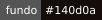 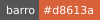 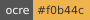 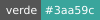 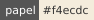

Tipografia: **Bowlby One** nos títulos e **Work Sans** nos textos.

## 🖨️ Folder impresso

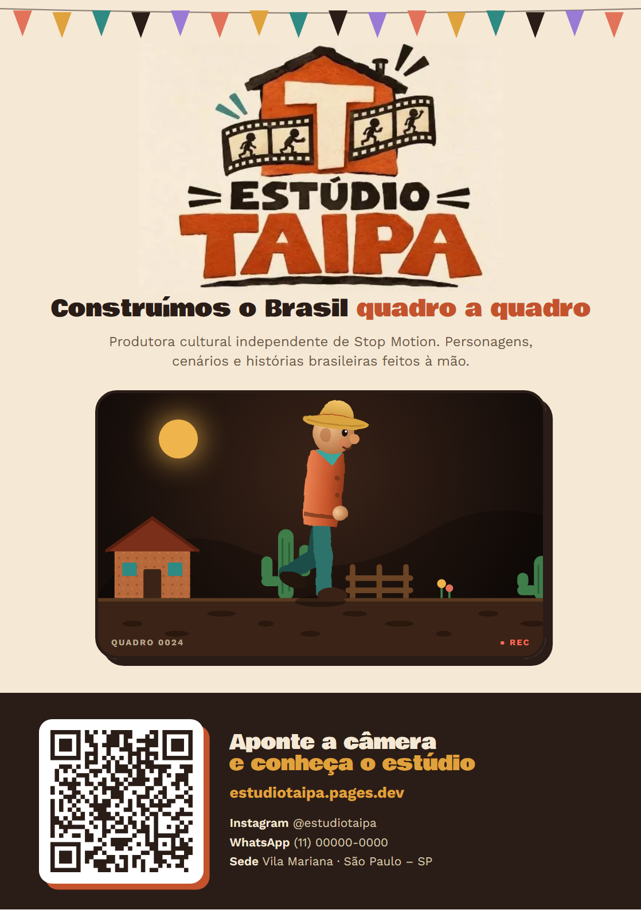

A pasta `folder/` traz um folder A5 de uma face, com a logo, o slogan, a cena do boneco e um **QR code** que leva ao site.

- `folder-taipa.html`: arquivo de origem
- `folder-estudio-taipa.pdf`: versão pronta para imprimir

<br clear="right"/>

## 📁 Estrutura

```
index.html        página completa: estrutura, estilos e scripts, sem frameworks nem build
img/              logo, ícone e imagem de prévia para redes sociais
folder/           folder impresso (HTML de origem, PDF e QR code)
_headers          cabeçalhos de segurança e cache do Cloudflare Pages
```

## ▶️ Rodar localmente

Não precisa instalar nada. Abra o `index.html` no navegador ou sirva a pasta:

```bash
python -m http.server 5173
```

E acesse `http://localhost:5173`.
